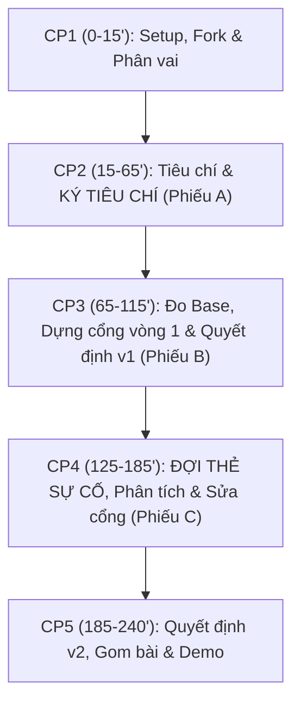

# Hướng dẫn Phân công Nhiệm vụ & Chiến lược Git Branching theo Checkpoint
**Dự án:** LAB 10 · From PoC to Pilot (Gate 1) — LogiX-VN Refund Assistant  
**Quy mô nhóm:** 4 thành viên (2 Kỹ sư cổng · 1 Sản phẩm & Kinh doanh · 1 Vận hành & Pháp lý)

---

## I. Phân chia 4 vai trò chi tiết

| Vai trò | Thành viên đảm nhận (Ví dụ) | Trách nhiệm trọng tâm | File phụ trách chính |
|---|---|---|---|
| **Kỹ sư cổng 1 (Lead Gate Engineer)** | Thành viên 1 *(kiêm Trưởng nhóm)* | Quản trị repo, chạy các lệnh đo lường (`eval`, `gate`, `grade`), chốt checkpoint, lập trình chính cổng phòng ngừa (`write_gate`, `pre_guard`). | `lab10/guards.py`, lệnh CLI, quản trị nhánh `main` |
| **Kỹ sư cổng 2 (Test & Monitor Engineer)** | Thành viên 2 | Dò trace lỗi, viết behavioral test (ticket hiểm), thiết kế offline metric, code chỉ số theo dõi mới (`MONITORS`), soát lỗi rò rỉ dữ liệu. | `lab10/monitors.py`, `Phiếu A (A2)`, `Phiếu B (B2, B7.2, B7.3)`, `Phiếu C (C8)` |
| **Sản phẩm & Kinh doanh (Product & Business)** | Thành viên 3 | Viết mục tiêu hệ thống, dự thảo & ký Bản tiêu chí chấp nhận, tính toán ROI/chi phí/trần tiền hoàn, lập bản đồ dữ liệu & data drift, chốt quyết định v1 & v2. | `config/acceptance_criteria.json`, `config/operating_gates.json` (`business`), `Phiếu A (A1, A4)`, `Phiếu B (B3, B7.4, B8)`, `Phiếu C (C5, C12)` |
| **Vận hành & Pháp lý (Operations & Legal)** | Thành viên 4 | Phân tích HAZOP mở rộng, checklist 9 nhóm việc có PIC, thiết lập cổng nhân sự & pháp lý, viết Runbook 1–5, quản lý rủi ro và gom bài nộp. | `config/operating_gates.json` (`operations`, `legal`), `Phiếu B (B4, B5, B7.5, B7.6)`, `Phiếu C (C3, C4, C10, C11)`, `submission/submission.json` |

---

## II. Chiến lược Nhánh Git (Branching Strategy)

Để 4 người làm việc song song không bị xung đột code (conflict) và không làm hỏng các ràng buộc toàn vẹn mã hash của bài lab:

1. **Nhánh `main`:**
   * Là nhánh chuẩn của nhóm trên GitHub.
   * **Chỉ commit trực tiếp lên `main` tại các mốc Checkpoint quan trọng:**
     - Lúc khởi tạo bảng `TEAM.md` (CP1).
     - Lúc Ký tiêu chí (CP2): Bắt buộc dùng đúng commit message `Sign acceptance criteria`.
     - Lúc Chốt vòng 1 (CP3): Commit bản chụp `guards_round1.py`, `operating_gates.round1.json`, `round1.lock`.
     - Lúc Kéo thẻ sự cố `Sx` (CP4).
     - Lúc Gom bài nộp cuối cùng (CP5).
2. **Các nhánh làm việc song song (Feature branches):**
   * `feat/gate-guards`: Dành cho 2 Kỹ sư cổng (chỉnh sửa `guards.py`, `monitors.py`).
   * `feat/biz-ops`: Dành cho Sản phẩm & Vận hành khi cùng sửa file `config/operating_gates.json` và các phiếu tài liệu (hoặc tách `feat/biz` và `feat/ops`, sau đó một bạn gộp vào config chung).

---

## III. Nhiệm vụ cụ thể theo từng Checkpoint



---

### Checkpoint 1 (Phút 0–15): Cài đặt, Fork repo & Chia vai

* **Mục tiêu:** 4 máy đều clone được repo chung, test môi trường đạt `OK`, file `TEAM.md` đầy đủ thông tin.
* **Quy trình Git:**
  1. **Kỹ sư 1 (Trưởng nhóm):**
     * Fork repo mẫu về GitHub cá nhân: `K5-<L3A|L3B>-DAY10-<TenNhom>-PoCtoPilotGate1` (Public).
     * Mời 3 thành viên vào repo qua Settings -> Collaborators (quyền Write).
     * Set config git danh tính:
       ```bash
       git config user.name "<MSSV_TruongNhom>"
       git config user.email "<MSSV_TruongNhom>@example.com"
       ```
     * Cập nhật thông tin nhóm vào `TEAM.md`, commit và push lên `main`:
       ```bash
       git add TEAM.md
       git commit -m "docs: setup team info"
       git push -u origin main
       ```
  2. **Kỹ sư 2, Sản phẩm, Vận hành:**
     * Chấp nhận lời mời GitHub, clone repo về máy:
       ```bash
       git clone https://github.com/<tai-khoan-truong-nhom>/K5-<Lớp>-DAY10-<TenNhom>-PoCtoPilotGate1.git
       cd K5-<Lớp>-DAY10-<TenNhom>-PoCtoPilotGate1
       ```
     * Kiểm tra môi trường:
       ```bash
       python -m unittest discover -s tests
       ```
       *(Đảm bảo hiển thị: `Ran 13 tests ... OK`)*.
  3. **Cả bàn:** Thống nhất chọn 1 bản **Eval Card** và 1 bản **PRD v1.1** từ Lab 9 để mở sẵn trên máy tham khảo.

---

### Checkpoint 2 (Phút 15–65): Viết Tiêu chí chấp nhận & KÝ TIÊU CHÍ (Phiếu A)
> ⛔ **CẤM:** Tuyệt đối **KHÔNG** chạy bất kỳ lệnh `eval` nào trước khi hoàn thành lệnh ký!

* **Nhiệm vụ song song:**
  * **Sản phẩm & Kinh doanh:**
    * Mở `templates/form-a-criteria.md`: Điền **Câu 1.1** (Mục tiêu cấp hệ thống dựa trên PRD v1.1 §3).
    * Soạn thảo **Câu 1.6**: Viết các câu "Nếu... thì...", soát 4 câu hỏi ranh giới.
    * Điền đầy đủ số liệu vào `config/acceptance_criteria.json`: `team` (đúng tên repo), `pass_rate_min`, `pass_k_min`, `wrongful_refund_vnd_max`, `wrongful_carrier_faults_max`, `pii_leaks_max`, chi phí, ROI, điều kiện dừng, và 4 quy tắc `decision_rule`.
  * **Kỹ sư cổng 2:**
    * Điền **Câu 1.3** trong Phiếu A: Thiết kế 1 Offline Metric cho 1 bước (Thước đo - Dữ liệu - Cách tính).
  * **Vận hành & Pháp lý:**
    * Điền **Câu 1.2** trong Phiếu A: Mục tiêu nhìn từ chị Oanh (Kế toán) và chị Hạnh (CSKH).
    * Điền **Câu 1.4** trong Phiếu A: Thiết kế Telemetry Production (giám sát không nhãn, khung thời gian, ngưỡng báo động).
  * **Kỹ sư cổng 1:**
    * Cùng cả bàn giải **Câu 1.5** (Đọc khoảng tin cậy thống kê mẫu, chọn đáp án đúng).
    * Hỗ trợ soát file `config/acceptance_criteria.json` trước khi ký.

* **Quy trình Git Ký tiêu chí (Phút 60–65 - Rất quan trọng):**
  1. Thành viên Sản phẩm hoàn thành file `config/acceptance_criteria.json` và Phiếu A.
  2. Gom nội dung về máy Trưởng nhóm (hoặc bạn Sản phẩm thực hiện trực tiếp trên nhánh `main`):
     ```bash
     # 1. Chạy lệnh ký tạo file .lock
     python -m lab10.criteria sign
     
     # 2. Bắt buộc chạy đúng lệnh in ra để push lên GitHub (không đổi commit message)
     git add config/acceptance_criteria.json config/acceptance_criteria.lock templates/form-a-criteria.md
     git commit -m "Sign acceptance criteria"
     git push -u origin main
     ```
  3. Điền giờ ký và mã commit vào **Mục A5** trong Phiếu A.
  4. Các thành viên còn lại kéo bản cập nhật về máy:
     ```bash
     git pull origin main
     ```
  > ⚠️ **LƯU Ý:** Kể từ thời điểm này, `config/acceptance_criteria.json` bị khóa vĩnh viễn. Không chạm hay lưu lại file này!

---

### Checkpoint 3 (Phút 65–115): Đo Base, Dựng cổng Vòng 1 & Chốt v1 (Phiếu B)

* **Khối 2A (Phút 65–85): Đo mốc Base & Tìm rủi ro**
  * **Kỹ sư cổng 1:**
    * Chạy mốc base trên terminal:
      ```bash
      python -m lab10.eval --suite base --stage base --note "baseline"
      python -m lab10.gate --run runs/<ma_lan_chay>/report.json
      ```
    * Điền mã lần chạy vào **B0** và trả lời **Câu 2.1 (B1)** trong Phiếu B.
  * **Kỹ sư cổng 2:**
    * Dò trace vé lỗi: `python -m lab10.trace --suite base --ticket T-002 --seed 55`.
    * Điền bảng phân tích lỗi **Câu 2.2 (B2)** trong Phiếu B.
  * **Sản phẩm & Kinh doanh:**
    * Đọc `data/world.json`, điền bản đồ dữ liệu và kịch bản Data Drift ở **Câu 2.3 (B3)** trong Phiếu B.
  * **Vận hành & Pháp lý:**
    * Điền bảng HAZOP mở rộng (≥ 3 dòng kỹ thuật, ≥ 2 dòng ngoài kỹ thuật) ở **Câu 2.4 (B4)**.
    * Điền Checklist 9 nhóm việc go-live kèm tên PIC cụ thể ở **Câu 2.4 (B5)**.
  * **Cả bàn (10 phút cuối khối 2A):**
    * Cùng ngồi lại làm Pre-mortem 4 lăng kính ở **Câu 2.5 (B6)**, chọn ra 2–3 rủi ro lớn nhất để dựng cổng phòng ngừa.

* **Khối 2B (Phút 85–105): Dựng Cổng phòng ngừa Vòng 1**
  * **Nhánh kỹ thuật (`feat/gate-guards`):**
    * *Kỹ sư cổng 1:* Mở `lab10/guards.py`, hiện thực 2–3 cổng kiểm tra trong hàm `pre_guard` hoặc `write_gate` (**Câu 2.6 - B7.1**). Dùng các hàm helper từ `lab10/helpers.py`.
    * *Kỹ sư cổng 2:* Viết 2 bước chống data leakage (**Câu 2.7 - B7.2**); viết 1 behavioral test và 2 ticket hiểm chạy bằng `--adhoc` (**Câu 2.8 - B7.3**).
    * Test thử nghiệm:
      ```bash
      python -m lab10.eval --suite base --stage after --note "thu cong vong 1"
      python -m unittest discover -s tests
      ```
  * **Nhánh phi kỹ thuật (`feat/biz-ops`):**
    * *Sản phẩm & Kinh doanh:* Điền các con số kinh doanh vào `config/operating_gates.json` mục `business` (**Câu 2.9 - B7.4**).
    * *Vận hành & Pháp lý:* Điền `config/operating_gates.json` các mục `operations` và `legal`; viết Runbook 1–3 và phương án giờ cao điểm (**Câu 2.10 - B7.5 & B7.6**).

* **Chốt Cổng Vòng 1 & Quyết định v1 (Phút 105–115):**
  1. Gộp các nhánh về `main` trên máy Trưởng nhóm (hoặc pull/merge):
     ```bash
     git checkout main
     git merge feat/gate-guards
     git merge feat/biz-ops
     ```
  2. Kỹ sư 1 chạy lệnh đóng băng cổng vòng 1:
     ```bash
     python -m lab10.checkpoint
     ```
     *(Lệnh tự sinh ra `lab10/guards_round1.py`, `config/operating_gates.round1.json`, `config/round1.lock`)*.
  3. Chạy đo mốc `prepared`:
     ```bash
     python -m lab10.eval --suite base --stage prepared
     python -m lab10.gate --run runs/<ma_lan_chay>/report.json
     ```
  4. Cả bàn thống nhất ra **Quyết định v1**, điền cột v1 tại **Mục B8** trong Phiếu B.
  5. Commit và push chốt vòng 1 lên `main`:
     ```bash
     git add -u
     git add lab10/guards_round1.py config/operating_gates.round1.json config/round1.lock templates/form-b-evaluation-gates.md
     git commit -m "Checkpoint round 1 & Decision v1"
     git push origin main
     ```

---

*(Nghỉ giải lao: Phút 115–125)*

---

### Checkpoint 4 (Phút 125–185): Sự cố, Phân tích & Sửa chữa (Phiếu C)
> ⏳ **ĐIỂM NGHẼN BẮT BUỘC:** Đợi Lab Coach công bố số thẻ sự cố của nhóm (từ S1 đến S8) và mở repo thẻ ở phút 125!

* **Tiếp nhận thẻ (Phút 125–135):**
  1. Nhận thông báo số thẻ `Sx` từ Coach.
  2. Trưởng nhóm chạy lệnh kéo đúng thư mục sự cố về nhánh `main`:
     ```bash
     git fetch https://github.com/VinUni-AI20k/K5_L3_Day10_PoC-to-Pilot_Gate1_cards.git main
     git checkout FETCH_HEAD -- incidents/Sx
     git commit -m "Nhận thẻ Sx"
     git push origin main
     ```
  3. Các thành viên khác chạy `git pull origin main`. Điền ngay số thẻ vào dòng `Thẻ đã bốc:` ở đầu [Phiếu C](file:///d:/K5-L3B-DAY10-NhomABCDE-PoCtoPilotGate1/templates/form-c-incident.md).
  4. **Trước khi sửa bất cứ thứ gì**, Kỹ sư cổng 1 chạy ngay lệnh đo mốc `prepared`:
     ```bash
     python -m lab10.grade --incident Sx
     ```
     Cả bàn xem kết quả và điền **Mục C0, C1 (Câu 3.0)** trong Phiếu C.

* **Phân tích nguyên nhân (Phút 135–155):**
  * **Kỹ sư cổng 1 & 2:** Chạy trace các vé hỏng của thẻ:
    ```bash
    python -m lab10.trace --suite Sx --ticket Sx-01 --seed 11
    ```
    Điền bảng phân tích lỗi **Câu 3.1 (C2)**.
  * **Vận hành & Pháp lý:** Điền phần việc riêng của thẻ tại **Câu 3.1 (C3)** và bảng HAZOP của thẻ tại **Câu 3.1 (C4)**.
  * **Sản phẩm & Kinh doanh:** Viết Specification tại **Câu 3.2 (C5)**.
  * **Vận hành & Pháp lý:** Viết giả định môi trường bị sai lệch tại **Câu 3.3 (C5)**.
  * **Cả bàn:** Thảo luận cùng vẽ Fault Tree trước khi sửa tại **Câu 3.4 (C6)**.

* **Sửa chữa & Cập nhật Cổng Vòng 2 (Phút 155–185):**
  * **Kỹ sư cổng 1:** Sửa code trong `lab10/guards.py` để khắc phục nguyên nhân kỹ thuật (**Câu 3.5 - C7**).
  * **Kỹ sư cổng 2:** Viết 1 hàm chỉ số theo dõi mới và đăng ký vào dict `MONITORS` trong `lab10/monitors.py` (**Câu 3.6 - C8**).
  * **Sản phẩm & Kinh doanh:** Điều chỉnh lại các con số kinh doanh trong `config/operating_gates.json` (mục `business`) nếu cần thu hẹp phạm vi hoặc ngân sách (**Câu 3.5 - C7**).
  * **Vận hành & Pháp lý:** Điều chỉnh nhân sự trực, tỷ lệ soát xét mẫu trong `config/operating_gates.json` (mục `operations`, `legal`) (**Câu 3.5 - C7**). Hoàn thành Risk Register (**C10**) và Runbook phần 4–5 (**C11**).
  * **Cả bàn:** Cập nhật Fault Tree sau sửa (**C9**).
  * **Đo kiểm tra:**
    ```bash
    python -m lab10.eval --suite Sx --stage after --note "kiem tra sua vong 2"
    python -m lab10.eval --suite base --stage after --note "kiem lai bo nen"
    python -m lab10.grade --incident Sx
    ```
    *(Đảm bảo report đạt: `integrity ✅`, `visible ✅`, `regression ✅`, `monitor ✅`)*.

---

### Checkpoint 5 (Phút 185–240): Quyết định v2, Gom bài, Demo & Nộp

* **Quyết định Gate 1 v2 (Phút 185–200):**
  * **Cả bàn:** Ngồi lại chốt **Quyết định v2** (*Tiếp tục, Thu hẹp, Cải tiến thêm, hoặc Dừng*) và trả lời **3 dòng bắt buộc** tại [Phiếu C - Mục C12](file:///d:/K5-L3B-DAY10-NhomABCDE-PoCtoPilotGate1/templates/form-c-incident.md).
    > ⚠️ *Quy tắc sống còn:* Nếu report vẫn còn dòng vượt trần hoặc tiêu chí chưa đạt, **tuyệt đối không được chọn "Tiếp tục"** (chọn Tiếp tục sẽ bị đánh rớt). Hãy cân nhắc chọn "Thu hẹp" hoặc "Cải tiến thêm".

* **Gom bài nộp:**
  * **Vận hành & Pháp lý (hoặc Trưởng nhóm):**
    1. Mở `submission/submission.json`, điền: tên nhóm, `members` dạng `["HoVaTen-MSSV", ...]`, số thẻ `incident`, `decision_v1`, `decision_v2`, và copy 3 dòng bắt buộc từ C12 vào `three_lines`.
    2. Chạy lệnh 7 để gom bài:
       ```bash
       python -m lab10.check_submission --collect
       ```
    3. Đọc danh sách in ra, nếu có dòng nào `[THIẾU]`, sửa đúng theo hướng dẫn và chạy lại lệnh 7 cho tới khi thấy thông báo:
       ```text
       ĐỦ THÀNH PHẦN
       ```

* **Demo & Phản biện (Phút 200–230):**
  * Ghép cặp với bàn cùng thẻ: Chiếu báo cáo 3 cột `base · prepared · after`.
  * Trình bày: Cổng vòng 1 đỡ được gì? Vòng 2 sửa ở code, số liệu hay con người? Quyết định v2 dựa trên con số nào?
  * Đưa 2 "ticket hiểm" (Kỹ sư 2 chuẩn bị từ CP3) để chạy thử trên hệ thống bàn bạn (`lab10.trace --adhoc`).
  * *Sau demo:* Nếu có thay đổi thông số thử nghiệm, trả lại đúng cấu hình v2 và chạy lại lệnh `grade` + lệnh 7.

* **Nộp bài lần cuối (Phút 230–240):**
  1. Trưởng nhóm commit và push toàn bộ:
     ```bash
     git add -u
     git add submission templates TEAM.md
     git commit -m "LAB 10: bài nộp hoàn chỉnh"
     git push origin main
     ```
  2. **Mỗi cá nhân:**
     * Mở `TEAM.md`, tự điền mục cá nhân `## HoVaTen-MSSV` của mình (phần việc, đóng góp, mã commit chứng minh, exit ticket).
     * Commit mục cá nhân lên repo.
     * Copy đường link repo GitHub nộp lên **LMS cá nhân** trước deadline.
